# Daybook

A personal planner for projects, tasks and Google Calendar, on a phone and a computer.

- Projects break down into sub-projects and tasks. Checking off a task moves its project forward.
- Plan a day or a week as a simple list, or as time blocks next to your calendar events.
- Drag and drop everywhere, including press-and-hold on phones.
- Open any task or project to keep notes and steps.
- Ask Claude to plan your week, break down a task, or point out what's at risk.
- Give any task a link back to where its notes live, like a Thymer page, and open it in one tap.
- Connect Daybook to Claude so any Claude chat can read and change your tasks.

To set it up, follow [SETUP.md](SETUP.md).

## A look around

These screenshots use made-up sample data. Daybook's default look is Ink, a warm dark theme.

**The week in time blocks.** Tasks sit next to your Google Calendar events, which show as striped outlines so they read as fixed time. A stopwatch marks time you actually recorded.

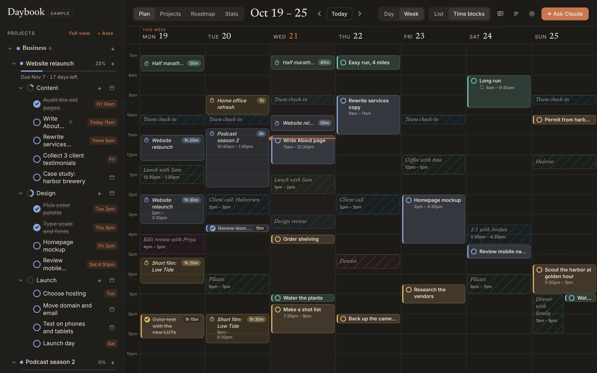

**The week as a list.** The same week without times, for when you just want to know what's on each day.

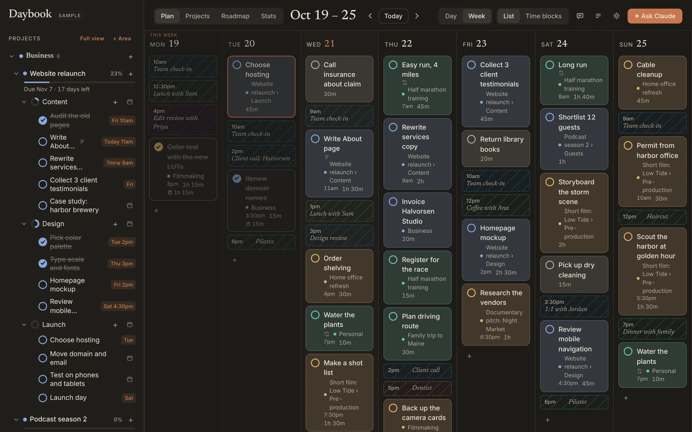

**Quiet.** Everything but your tasks fades away. Tap the date for the controls.

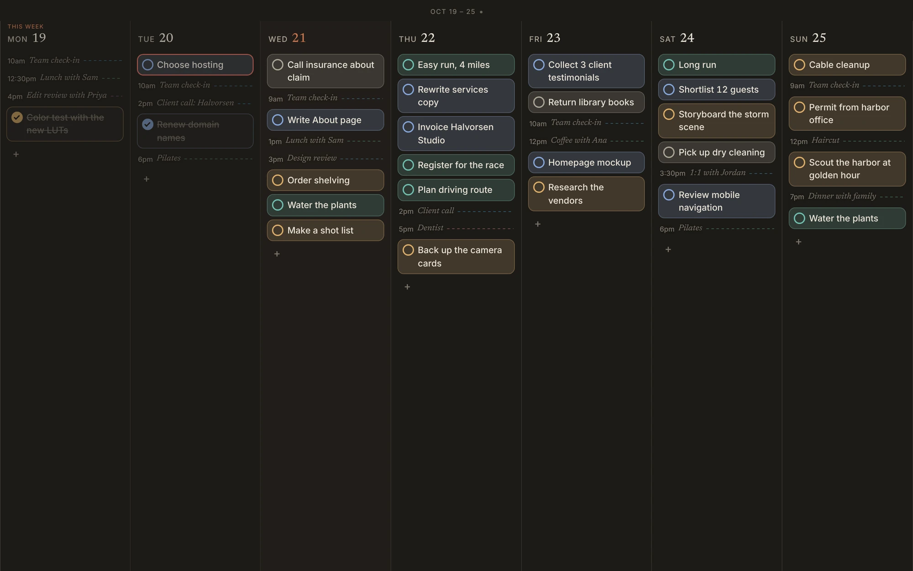

**One day, with the timer running.** Press ▶ on a task to record how long it really takes.

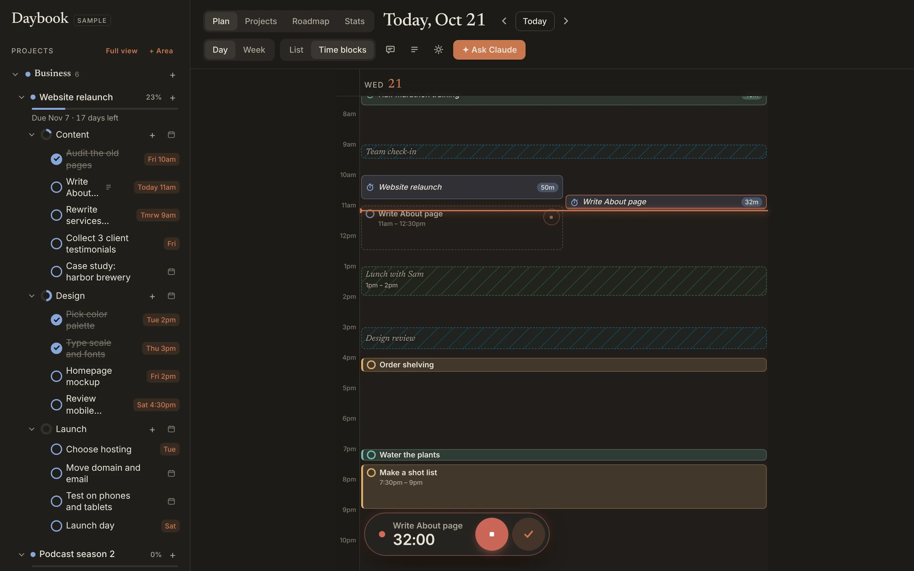

**Projects.** Areas like Business, Filmmaking and Personal hold projects, which break down into sub-projects and steps. Checking off a step moves its project forward.

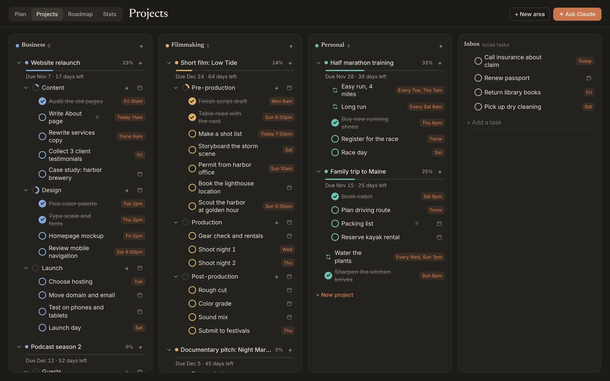

**Open any task** to see its notes, steps, repeat, milestone and recorded time.

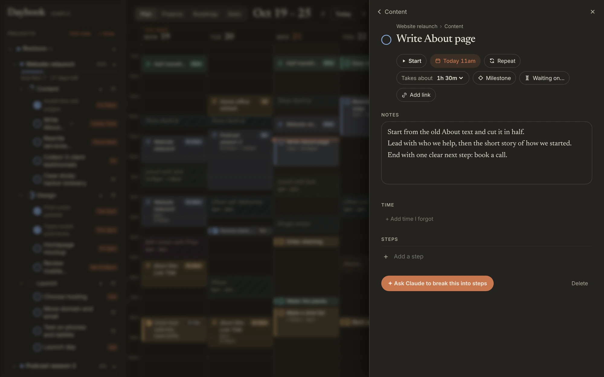

**Roadmap.** Every project as a bar on a timeline, with milestones and hard deadlines. The strip along the top weighs each week's plans against the hours you have free.

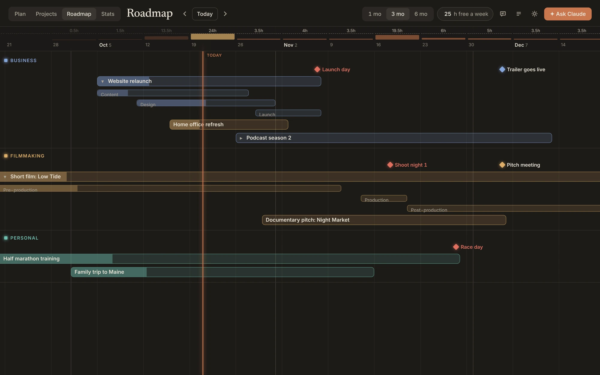

**Stats.** Where your time went, by area and project, with a year of days in squares.

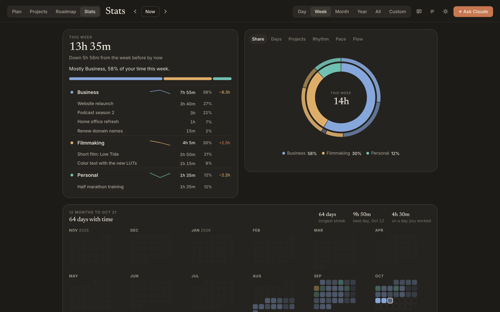

**Ask Claude.** Ask it to plan your week, break a task into steps, or point out what's at risk. Every change it makes can be undone.

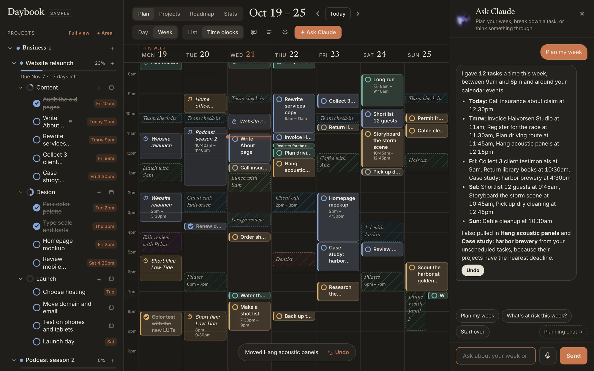

**Notes from Claude.** A Claude chat you plan with can leave you a note about what it changed.

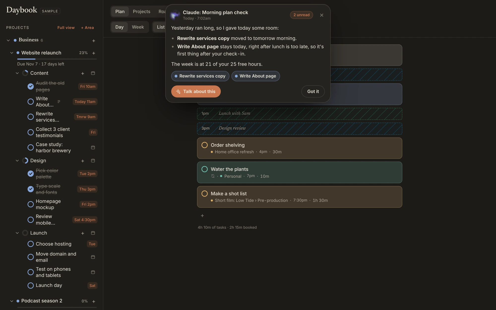

### On a phone

Daybook installs to the home screen and syncs with the computer.

  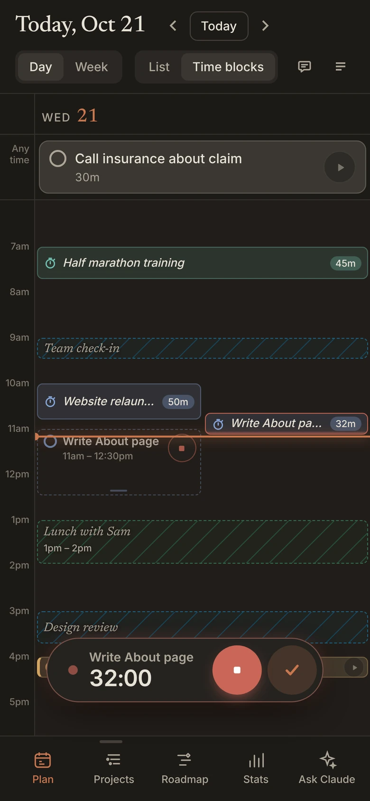
  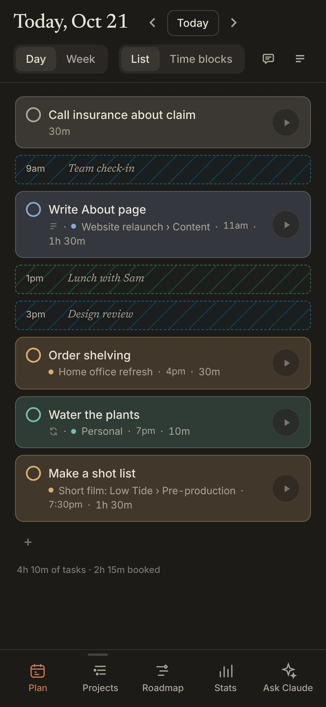
  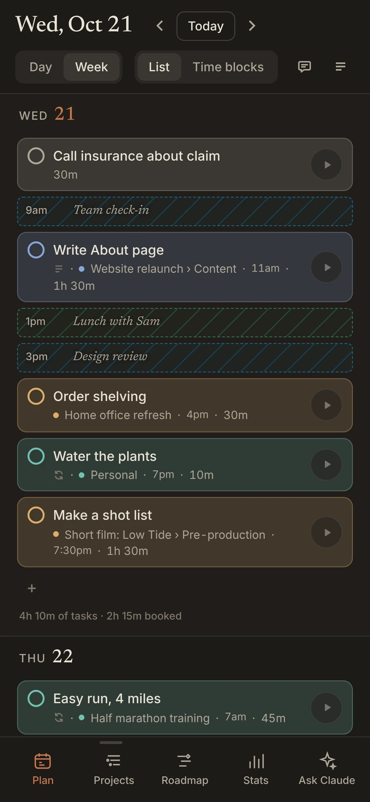

  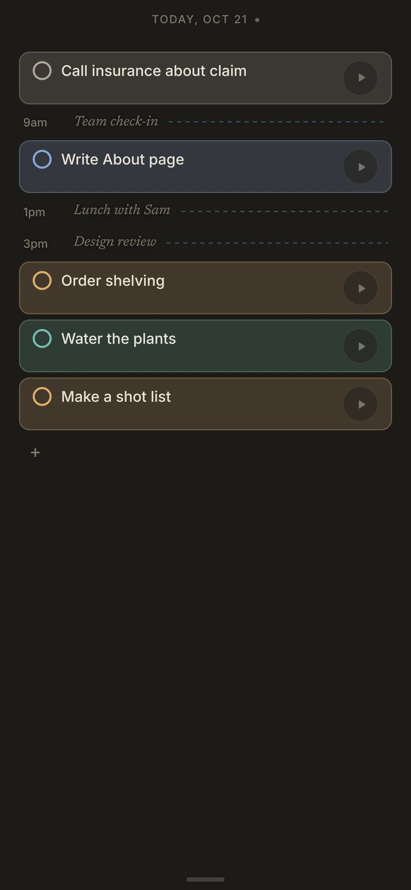
  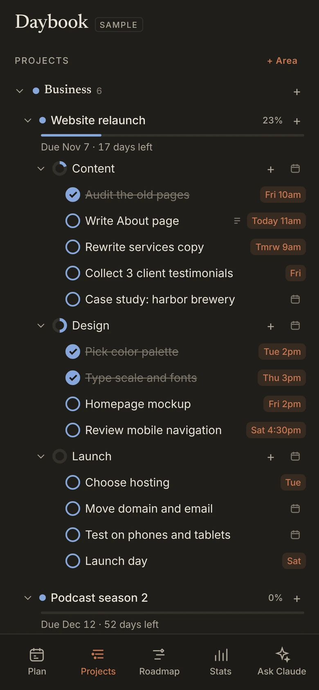
  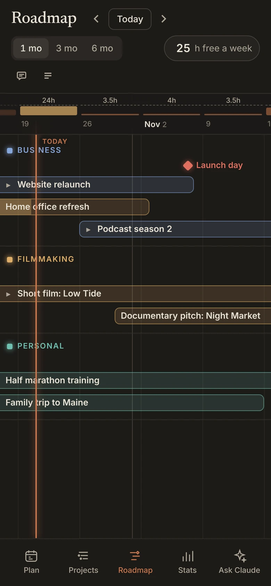

  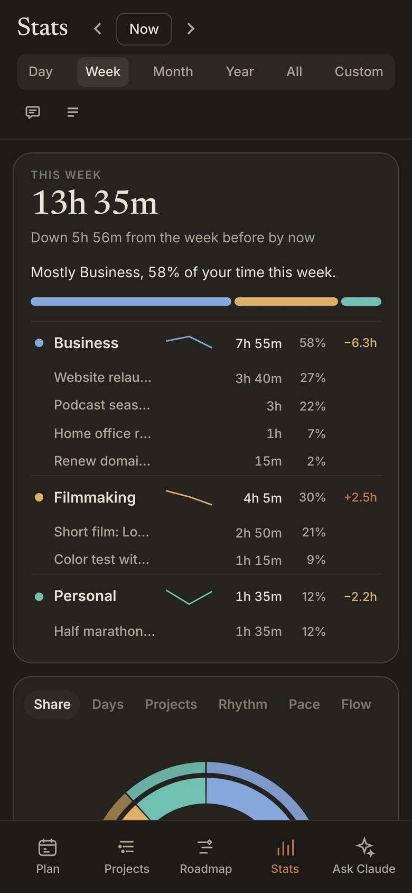
  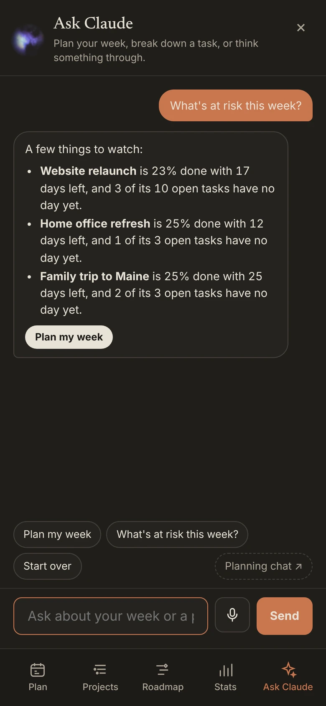

## How it's built

- A plain HTML, CSS and JavaScript web app with no build step (`index.html`, `app.css`, `js/`). It installs to the home screen and works offline (`sw.js`, `manifest.webmanifest`).
- [Supabase](https://supabase.com) for Google sign-in, the database (`supabase/migrations`) and live sync between devices.
- Supabase Edge Functions:
  - `calendar` reads Google Calendar events. It is read-only.
  - `ask` sends the question and a summary of the planner to Claude. Claude proposes changes, and the app applies them with an Undo button.
  - `mcp` is a Claude connector (an MCP server). Its address carries a secret made in the app, stored only as a hash in `mcp_tokens`. It can list, add and change tasks.
  - `inkwell` and `inkwell-mcp` serve Inkwell, the writing app that shares this database (`writing_entries`). `inkwell` asks Claude for alternates; `inkwell-mcp` is Inkwell's own Claude connector, with its own secret (hashed in `inkwell_mcp_tokens`). It reads any of the writing and only adds to it, marking what it adds as Claude's.
  - `scribe` serves Scribe, the dictation app (repo laserbunny-coder/scribe): a recording comes in, is written out by the same speech service as Inkwell's Capture, and Claude rewrites it in a chosen mode. Modes are per person (`scribe_modes`, starting from `scribe/modes.ts`) and can be made or changed by voice. Devices connect from Inkwell with their own secret (hashed in `scribe_tokens`).
- GitHub Actions (`.github/workflows/deploy.yml`) updates the database and functions, then publishes the site to GitHub Pages on every push to `main`.

Opening `index.html` without Supabase settings runs the app with sample data stored only in that browser.

To run it locally, run `python3 -m http.server` in this folder and open http://localhost:8000.
